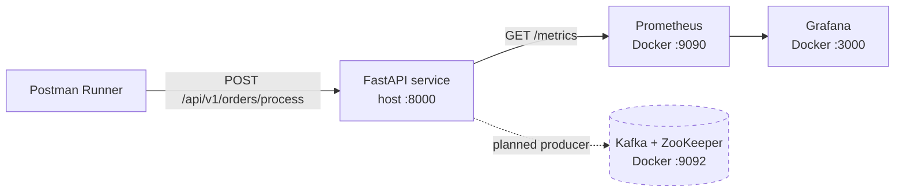

# Order Streaming Pipeline: API Testing & Observability Environment

A local, containerized environment for practising how a QA engineer tests and monitors an order-processing backend. A FastAPI service accepts orders, simulates database latency and random failures, and exposes Prometheus metrics. Docker Compose runs Kafka, ZooKeeper, Prometheus and Grafana alongside it. The API is tested with Postman collections and scripted assertions.

**Tech stack:** Python · FastAPI · Pydantic · Postman · Docker Compose · Prometheus · Grafana · Apache Kafka

---

## Why this project exists

Clicking "Send" in Postman proves very little. This project is built to practise the parts of QA that real teams care about:

- Testing an API against a system that fails and slows down **on purpose** (fault injection)
- Writing assertions that check the response body, not only the status code
- Observing a system through metrics: throughput, error ratio, and latency percentiles
- Running a reproducible multi-service environment with one command

---

## Architecture



| Component | Where it runs | Role |
|---|---|---|
| FastAPI app (`utils/main.py`) | Host machine, port 8000 | Order endpoint and `/metrics` endpoint |
| Prometheus | Docker, port 9090 | Scrapes `/metrics` every 2 seconds |
| Grafana | Docker, port 3000 | Dashboards on top of Prometheus |
| Kafka + ZooKeeper | Docker, port 9092 | Message broker (provisioned, see [Limitations](#limitations)) |
| Postman collection | Local | Functional tests and iterative runs |

---

## Project structure

```
order_streaming_pipeline/
├── config/
│   └── prometheus.yml        # Scrape configuration
├── utils/
│   └── main.py               # FastAPI service with Prometheus instrumentation
├── postman/                  # Exported collection and environment
├── docs/                     # Screenshots used in this README
├── docker-compose.yml        # Kafka, ZooKeeper, Prometheus, Grafana
├── requirements.txt
└── README.md
```

---

## Getting started

### Prerequisites

- Python 3.10+
- Docker Desktop (running)
- Postman (or Newman for the command line)

### 1. Clone and install

```bash
git clone https://github.com/<your-username>/order_streaming_pipeline.git
cd order_streaming_pipeline

python3 -m venv venv
source venv/bin/activate
pip install -r requirements.txt
```

### 2. Start the infrastructure

```bash
docker compose up -d
docker compose ps
```

### 3. Start the API

```bash
uvicorn utils.main:app --host 0.0.0.0 --port 8000
```

`--host 0.0.0.0` is required so the Prometheus container can reach the app on your machine.

### 4. Verify everything is up

| Check | URL | Expected |
|---|---|---|
| API docs | http://127.0.0.1:8000/docs | Swagger UI listing the endpoints |
| Metrics | http://127.0.0.1:8000/metrics | Prometheus text output |
| Prometheus targets | http://localhost:9090/targets | `order_processing_metrics` is **UP** |
| Grafana | http://localhost:3000 | Login `admin` / `admin` |

### 5. Stop everything

```bash
docker compose down
```

---

## API reference

### `POST /api/v1/orders/process`

Request body:

```json
{
  "customer_id": "CUST-1001",
  "item_category": "electronics",
  "order_value": 249.99
}
```

| Field | Type | Required |
|---|---|---|
| `customer_id` | string | yes |
| `item_category` | string | yes |
| `order_value` | number | yes |

Successful response (`200`):

```json
{
  "status": "QUEUED_ON_KAFKA_STREAM",
  "trackingId": "TRK-4821",
  "latency_ms": 213.4
}
```

Simulated failure (about 5% of requests, currently returned with HTTP `200`):

```json
{
  "status": "REJECTED",
  "message": "Internal Queue Timeout Exception"
}
```

Invalid body (missing field or wrong type) returns `422 Unprocessable Entity`.

### `GET /metrics`

Exposes Prometheus metrics in text format.

---

## Behaviour built in for testing

| Behaviour | Implementation |
|---|---|
| Variable latency | `time.sleep(random.uniform(0.02, 0.45))`, so 20 to 450 ms |
| Random failures | About 5% of requests return a `REJECTED` response |
| Input validation | Pydantic model (`OrderPayload`) |

---

## Observability

### Metrics exposed

| Metric | Type | Labels | Purpose |
|---|---|---|---|
| `order_processing_total_volume_total` | Counter | `status`, `item_category` | Orders handled, split by outcome and category |
| `order_pipeline_latency_seconds` | Histogram | none | Processing latency, used for percentiles |

`prometheus_client` appends `_total` to counter names, so the counter is queried as `order_processing_total_volume_total`.

### Useful PromQL queries

```promql
# Orders per second
sum(rate(order_processing_total_volume_total[1m]))

# Failure ratio
sum(rate(order_processing_total_volume_total{status="FAILED"}[5m]))
  / sum(rate(order_processing_total_volume_total[5m]))

# p95 latency
histogram_quantile(0.95, sum(rate(order_pipeline_latency_seconds_bucket[5m])) by (le))
```

### Grafana setup

1. Open http://localhost:3000 and sign in with `admin` / `admin`.
2. Add a data source: **Prometheus**, URL `http://prometheus:9090`.
3. Create a dashboard with three panels using the queries above: throughput, failure ratio, p95 latency.

> Add a screenshot here: ``

---

## Testing

### Postman

The collection lives in `postman/`. Import both the collection and the environment file.

Request: `POST http://127.0.0.1:8000/api/v1/orders/process` with a raw JSON body.

Example test script:

```javascript
pm.test("Status code is 200", function () {
    pm.response.to.have.status(200);
});

pm.test("Order was queued", function () {
    const body = pm.response.json();
    pm.expect(body.status).to.eql("QUEUED_ON_KAFKA_STREAM");
    pm.expect(body.trackingId).to.match(/^TRK-\d{4}$/);
});

pm.test("Latency is reasonable", function () {
    pm.expect(pm.response.json().latency_ms).to.be.below(1000);
});
```

Run with **100 iterations** in the Collection Runner. Roughly 95% should pass, and the remaining failures come from the simulated rejections.

### Newman (command line)

```bash
npm install -g newman
newman run postman/order_streaming_pipeline.postman_collection.json \
  -e postman/FinTech-Staging.postman_environment.json -n 100
```

### Suggested negative test cases

| Case | Expected |
|---|---|
| Missing `customer_id` | 422 |
| `order_value` sent as a string | 422 |
| Empty body | 422 |
| Wrong HTTP method (GET) | 405 |
| Negative `order_value` | Currently accepted (see Known issues) |

---

## Troubleshooting

| Symptom | Cause and fix |
|---|---|
| Postman: "Request could not be sent" | Wrong URL. Use `http://127.0.0.1:8000/api/v1/orders/process`, with port and route. |
| Prometheus target is DOWN | Target must be `host.docker.internal:8000`, and uvicorn must run with `--host 0.0.0.0`. |
| `ModuleNotFoundError` for `fastapi` | Activate the venv: `source venv/bin/activate`. |
| Prometheus container restarts | Check YAML indentation in `config/prometheus.yml` (spaces, not tabs). |
| Kafka fails on first start | ZooKeeper wasn't ready yet. Run `docker compose up -d` again. |

---

## Limitations

Being upfront about what this project does and does not do:

- **Kafka is provisioned but not used by the API yet.** The response string `QUEUED_ON_KAFKA_STREAM` is a simulation. The service does not publish to a topic.
- **The database is simulated** with a random sleep.
- **Simulated rejections return HTTP 200.** A status-code-only assertion will not catch them, so tests must also check the response body.
- **Failed requests are not recorded in the latency histogram**, so the latency graph reflects successful orders only.
- **Order values are not validated for business rules**, for example a negative `order_value` is accepted.
- **Metrics are per process.** Running uvicorn with multiple workers would require Prometheus multiprocess mode.
- Credentials in `docker-compose.yml` are for local use only.

---

## Roadmap

- [ ] Return `503` for simulated failures instead of `200`
- [ ] Record latency for failed requests
- [ ] Add a real Kafka producer (`confluent-kafka`) and a consumer-based verification test
- [ ] Reject negative or zero `order_value`
- [ ] Add Prometheus alert rules (for example failure ratio above 10%)
- [ ] Add a load test with k6 or Locust and publish measured results
- [ ] Run the Postman collection in GitHub Actions with Newman
- [ ] Persist the Grafana dashboard as provisioned JSON

---

## What I learned

- Diagnosing "could not be sent" versus an HTTP error: no status code means the request never reached a server (wrong host or port), while 404, 422 and 500 mean it did.
- Reading the host and port from the server log and the route from the `@app.post` decorator, instead of guessing the URL.
- A passing test is not necessarily a meaningful one. A status-only assertion passes on rejected orders.
- Containers reach services on the host through `host.docker.internal`, not `localhost`.

---

## License

MIT. See `LICENSE`.
